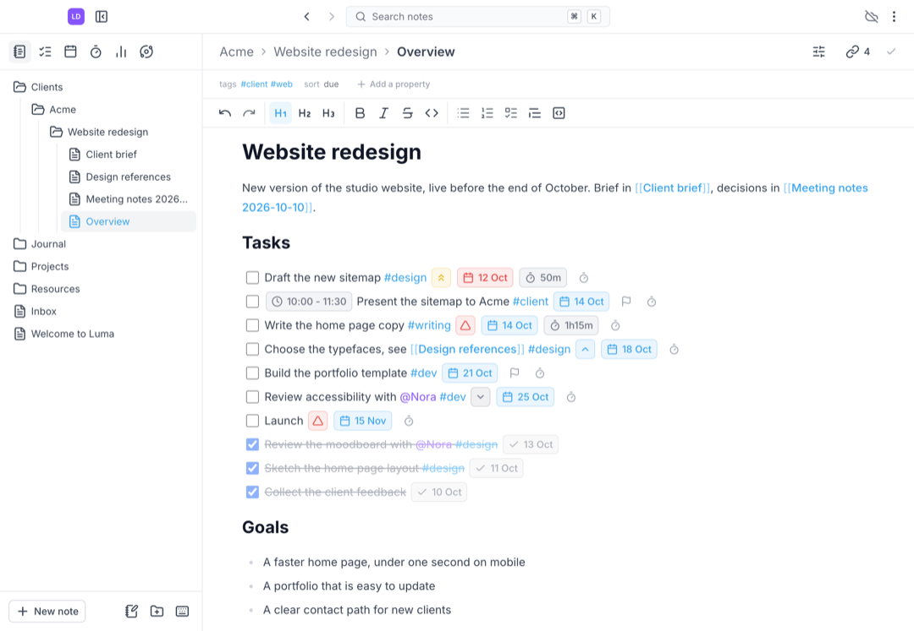
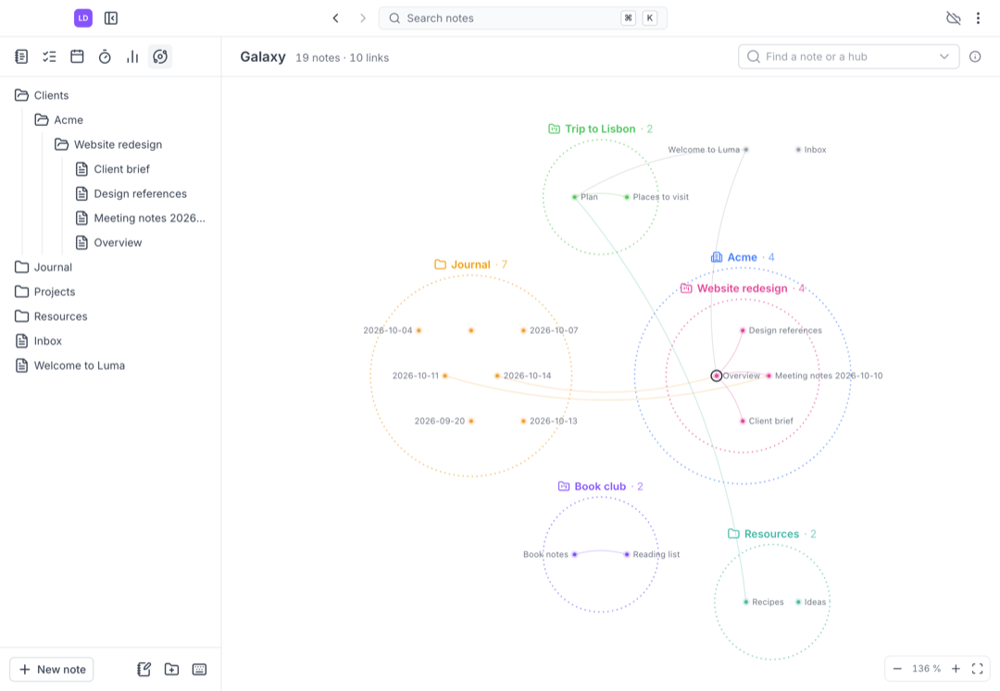
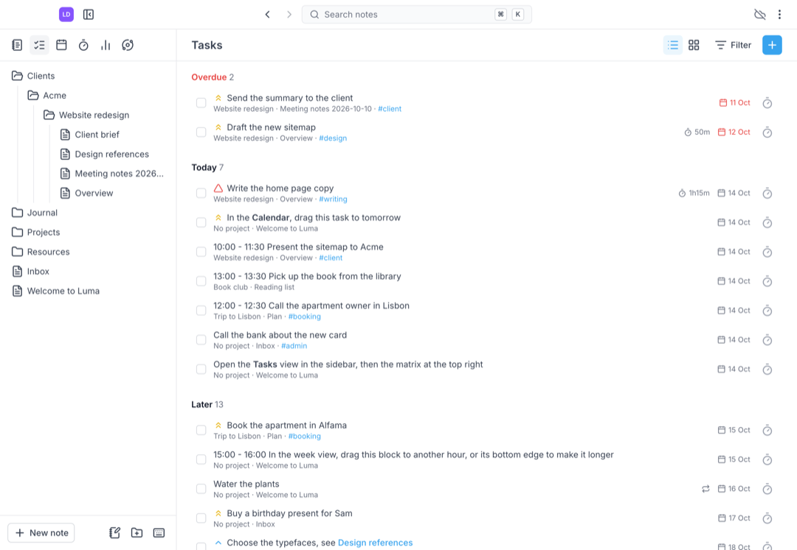
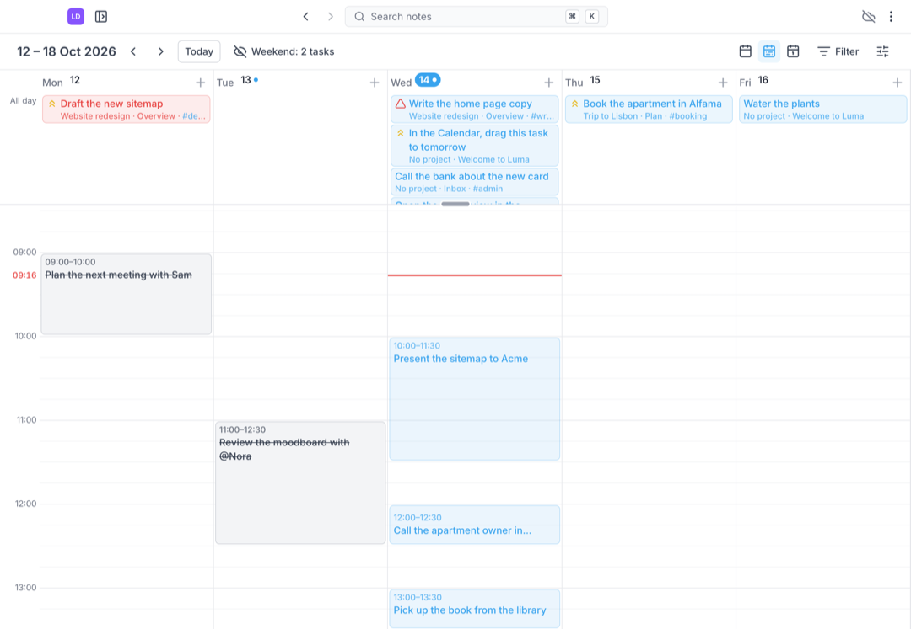
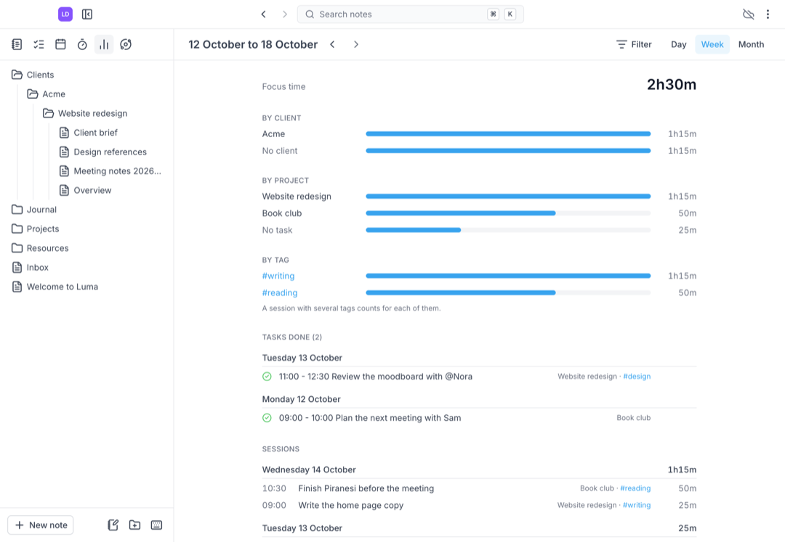

<p align="center"></p>

# Luma

Luma is a desktop app for notes, tasks and calendar, stored as plain Markdown files in a
folder of your choice, with optional sync to a GitHub repository.

This repository only hosts the releases. The source code is not public.

<picture>
  <source media="(prefers-color-scheme: dark)" srcset="screenshots/notes-dark.png" />
  
</picture>

## Download

Get the latest version from the [Releases](https://github.com/martinloic/luma-releases/releases/latest) page.

- macOS on Apple Silicon (M1 and later): `Luma-<version>-arm64.dmg`
- Intel Macs, Windows and Linux are not supported yet.

## Features

### Notes in plain Markdown

Your notes are Markdown files in a folder you choose (a vault), browsed as a tree. The
editor saves as you type and supports task lists, tables and `[[links]]` between notes,
with backlinks. A handle next to each line moves it elsewhere in the note. A button (or
`⌘⇧M`) switches a note to its Markdown source, saved exactly as typed. The files stay
readable in any other editor, and an existing Obsidian vault can be opened as is.

The properties of a note (its YAML frontmatter) show under its title: click one to edit it,
or add one as `key: value`. `#tags` written anywhere in a note, or in its `tags` property,
and `@mentions` of people are colored, suggested as you type them, and lead to their notes:
type `#` or `@` in the search, or `⌘`-click one.

### Galaxy

The Galaxy view draws every note of the vault, grouped by client, project and folder, with
the `[[links]]` between them. Hover a note to light its links and their direction, click it
for its panel (with its properties), double-click it to open it. From a note, Show in the
galaxy flies to it.

<picture>
  <source media="(prefers-color-scheme: dark)" srcset="screenshots/galaxy-dark.png" />
  
</picture>

### Projects and tasks

A project is a folder, and a task is a Markdown checkbox line in any note, with an optional
priority, due date and hours ([Obsidian Tasks](https://publish.obsidian.md/tasks/) format).
Tasks can repeat (every day, week, month or year): checking one adds the next occurrence.
The task view gathers the tasks of the whole vault: overdue, today, later and undated.
Tasks can carry `#tags`, shown in color and used to filter the views, and renamed or merged
from the settings.

In a note, Sort tasks (in the `/` menu, or `⌘⌥S`) puts the open tasks of a list first, by
due date, hours and priority, then the done ones; subtasks move with their task. Turn on
Sort tasks automatically in the note menu, and the lists of that note stay sorted each time
you check a task or change its date.

Projects can be grouped by client (`Clients/<client>/<project>/`), with a client filter and
the focus time per client. A note, a project or a client can be archived from the tree: it
moves to an `Archive` folder with the path it had, leaves the work views, stays in the
history, and can be restored.

<picture>
  <source media="(prefers-color-scheme: dark)" srcset="screenshots/tasks-dark.png" />
  
</picture>

The same tasks can be sorted in an Eisenhower matrix, by importance (priority) and
urgency (due date).

### Calendar and daily notes

Month, week and day views show the tasks on their due date. The week and the day place the
tasks that have hours on an hour grid, with a line for the current time. Add a task on a
day or a slot, drag it to another day or hour, resize it, or drop it on the All day band or
the No date list to remove its hours or its date, with undo. The weekend can be hidden. A
click on a day opens its daily note, or creates it.

<picture>
  <source media="(prefers-color-scheme: dark)" srcset="screenshots/calendar-dark.png" />
  
</picture>

### Focus

A Pomodoro timer of 15, 25 or 50 minutes, or with no end, on a task or on nothing in
particular. The time spent is added to the task line itself (`⏱ 1h15m`).

### Focus history

Every focus session is kept in the vault. The History view shows, for a day, a week or a
month, the focus time per client, per project and per tag, the tasks done and the sessions of
each day, with the tag, client and project filters. A click on a session or a task opens its
note at the task.

<picture>
  <source media="(prefers-color-scheme: dark)" srcset="screenshots/history-dark.png" />
  
</picture>

### Search and shortcuts

`⌘K` searches the names and the contents of the notes, lists the notes of a `#tag` or of an
`@person`, and runs actions such as a new task or a new project. Keyboard shortcuts cover
the frequent actions.

### GitHub sync

The vault can be synchronized both ways with a GitHub repository, through the Git of your
Mac. Each sync commit lists the files it changed, and is signed Luma: the syncs do not fill
your GitHub contribution graph. Conflicts never lose anything: both
versions are kept. Quitting Luma with changes not on GitHub yet offers to sync them first.
It requires Git and a GitHub authentication already set up on your Mac (SSH key or
`gh auth login`).

### Assistant

Ask questions about your notes and tasks to a local model run by
[Ollama](https://ollama.com) on your Mac: Luma chooses the notes and computes the tasks
(late, today, upcoming) it gives the model, and shows the notes used under each answer.
Off by default (Settings > Assistant). Nothing leaves your computer.

### Several vaults

Luma remembers the vaults of your Mac: switch between them from the vault menu, mark
favorites, and search them when you have many.

### Light and dark, English and French

The interface follows the light or dark theme of your Mac (or the one you choose), with an
accent color of your choice, in English or French.

## Limitations

Luma is young, and some things are not there (yet):

- **One vault open at a time**: switching vaults is quick, but two vaults cannot be open
  side by side, and only the open vault is synchronized.
- **Calendar**: tasks only, no events, no Google, Outlook or iCloud calendars, no daily
  note templates. Future occurrences of recurring tasks are not shown.
- **Tasks**: repeats of a plain interval only, no start or scheduled dates, no Kanban view.
- **Tags and people**: the tags written in the notes and the people mentioned cannot be
  renamed from Luma yet (the tags of tasks can).
- **Focus**: 15, 25 or 50 minutes or no end, no long breaks, a single end chime. Sessions
  cannot be edited or entered by hand, and the history has no charts or export. The time
  spent before version 0.2.0 is not in the history.
- **Links**: embedded notes (`![[note]]`) and block links are kept in the file but not
  displayed. Standard Markdown links to notes are not followed.
- **Renaming outside Luma**: renaming or moving notes in Finder or through Git does not
  update the `[[links]]` pointing to them. Rename and move notes in Luma.
- **GitHub sync**: Git must be installed on your Mac, and only GitHub repositories can be
  cloned. No version history or restore from Luma (Git keeps it).
- **Languages**: English and French only.

## First launch on macOS

Open the DMG and drag Luma into your Applications folder.

> [!IMPORTANT]
> Luma is not signed with an Apple Developer certificate yet, so macOS says it cannot verify
> the app on its first launch. This is expected: allow it once, with one of the methods
> below. The next launches open normally.

### Recommended: Terminal

The quickest way, one command:

```bash
xattr -dr com.apple.quarantine /Applications/Luma.app
```

Then open Luma normally.

### Or: System Settings

1. Open Luma: macOS says it cannot verify the app. Close the message.
2. Open System Settings > Privacy & Security, scroll down, and click **Open Anyway** next
   to the message about Luma.
3. Confirm.

### Try it on a demo vault

On the vault setup screen, **Try the demo vault** copies a small vault of notes, projects,
tasks and focus sessions to your Documents folder, with its dates moved to the current day.

## License

Luma is free to use, but it is not open source. See [LICENSE](LICENSE).
